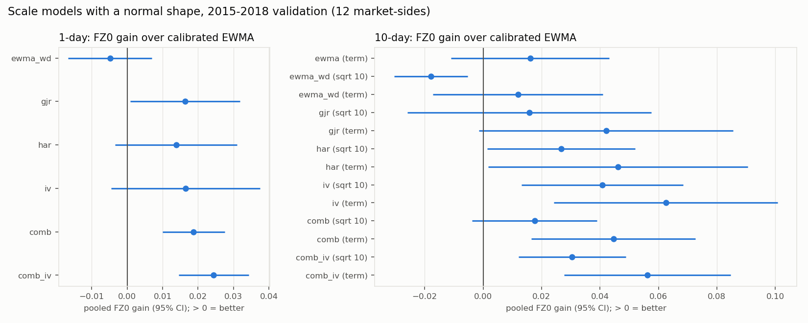
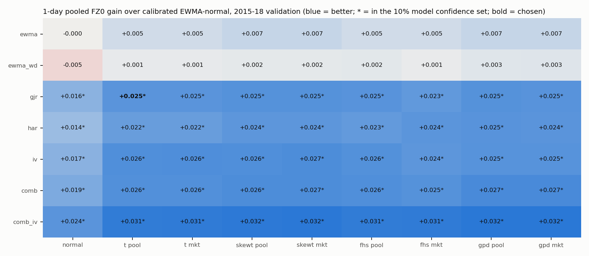

# Energy Tail Risk

**Question.** Can a daily Value-at-Risk and Expected Shortfall engine for energy futures positions (TTF, NBP, Henry Hub, Brent, WTI, EU carbon; 1-day and 10-day; single markets and a small portfolio) pass the standard risk-management backtests well enough for a risk desk to use?

It builds on [energy-vol-targeting](https://github.com/olivercdavies-su/energy-vol-targeting). That project found that volatility forecasts are good enough for sizing, but that the tails beyond the 95% level are not modelled well. Its data pipeline (contract-consistent returns built from exchange expiry rules) is reused here.

> **Status:** Phase 3 complete. The evaluation toolkit is built and checked by simulation, the final test is pre-registered in [`PROTOCOL.md`](PROTOCOL.md), and the volatility models, tail shapes and 1-day engine are built and evaluated on development data. The 2019–26 test window stays sealed until the frozen engine is run once. See [`PROJECT_LOG.md`](PROJECT_LOG.md).

## How the engine will be judged

Every forecast is scored on both tails: a unit long position (loses when prices fall) and a unit short (loses when they rise). There are two questions:
- **Is it calibrated?** Breach rates at 99% and 97.5%, and Expected Shortfall, are tested pooled across markets. Markets that crash together count as the partly redundant evidence they are. Supporting per-market tests: Kupiec, Christoffersen, dynamic quantile, Acerbi–Székely, Du–Escanciano, McNeil–Frey and the Basel traffic light.
- **Is it better than what desks use?** Historical simulation, RiskMetrics and calibrated EWMA are ranked by FZ0, a scoring function for VaR and ES jointly, with Diebold–Mariano tests and a model confidence set.

Each test's size and power at this project's sample sizes were checked by simulation first ([`results/p1_test_size.csv`](results/p1_test_size.csv)).

## First look at the tails (2011–2018, development data only)


After scaling by a volatility forecast, a Gaussian 99% VaR is breached on 0.7–2.2% of days per tail instead of 1%. Which tail is heavy depends on the market: oil's left tail (long positions) and NBP's right tail (short positions). Details and the other findings are in the project log.

## Scale models (2015–2018 validation, development data only)



- **1-day:** combinations of GJR-GARCH, HAR, weekday EWMA and implied vol beat calibrated EWMA on the joint VaR–ES score. A volatility model alone does not fix the 99% tail: with normal tails, long positions still breach 1.4–1.7% of the time. That is the job of the tail-shape models (Phase 3).
- **10-day:** each model's own term structure beats the square-root-of-time rule.

## Tail shapes and the 1-day engine (2015–2018 validation)



- Every volatility model was combined with every tail shape (normal, Student-t, skewed-t, filtered historical simulation, extreme-value GPD tails; each pooled across markets or per market). That makes 63 configurations.
- **Fat tails fix calibration:** with any fat-tailed shape and a non-EWMA volatility model, all six pooled calibration tests pass. With normal tails, 2–5 fail.
- **Which fat-tailed shape is used matters far less than which volatility model.**
- The pre-registered rule picks the simplest configuration that is statistically tied with the best and passes calibration: **GJR-GARCH with a pooled Student-t**. Across the 12 market-sides it has no Holm-adjusted rejection in any backtest. The choice is provisional until the learned models join the candidate set.

## Data and licensing

Daily Bloomberg futures data, 2010–2026. **Bloomberg's licence forbids redistributing the data, so none of it is in this repository, raw or derived.** The repo holds only code, aggregated results tables and charts.

Safeguards:
- `.gitignore` excludes `data/` and every common data-file format.
- `scripts/hooks/pre-commit` blocks commits of anything under a `data/` folder, data-file formats, notebooks, CSVs outside `results/`, results files long enough to be a daily series, and files over 2 MB.
- `scripts/hooks/commit-msg` keeps authorship clean.

Enable both once per clone:
```
git config core.hooksPath scripts/hooks
```

## Reproducing

Requires the Bloomberg workbook (not distributed) and Python 3.11+.

```
pip install -e ".[dev]"
git config core.hooksPath scripts/hooks
cp <your workbook>.xlsx data/raw/
python scripts/build_data.py        # -> data/processed/ (gitignored)
python scripts/p0_reverify.py       # re-verification tables
python scripts/p0_tails.py          # tail exploration tables and chart
python scripts/p1_test_size.py      # size and power of every test, by simulation (~15 min)
python scripts/p1_baselines.py      # baselines on 2012-18 development data
python scripts/p2_scale.py          # volatility models, 2012-18
python scripts/p3_tails.py          # tail shapes, all configurations, the selection rule
pytest                              # real-data tests skip without the workbook
python scripts/mutation_check.py    # injects known bugs; each must make a test fail
```

## Licence

Code: MIT (to be added). Data: not included, see above.
