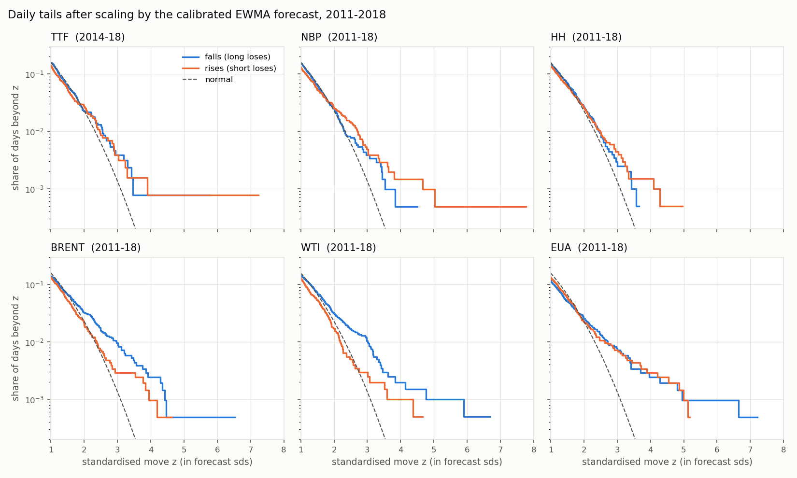

# Energy Tail Risk

**Question.** Can a daily Value-at-Risk and Expected Shortfall engine for energy futures positions (TTF, NBP, Henry Hub, Brent, WTI, EU carbon; 1-day and 10-day; single markets and a small portfolio) pass the standard risk-management backtests well enough for a risk desk to use?

It builds on [energy-vol-targeting](https://github.com/olivercdavies-su/energy-vol-targeting). That project found that volatility forecasts are good enough for sizing, but that the tails beyond the 95% level are not modelled well. Its data pipeline (contract-consistent returns built from exchange expiry rules) is reused here.

> **Status:** session 1 complete. The repo and data guard are set up, the earlier findings re-verified, tail behaviour explored on 2011–18, and a phased plan proposed. See [`PROJECT_LOG.md`](PROJECT_LOG.md).

## First look at the tails (2011–2018, development data only)



After scaling by a volatility forecast, a Gaussian 99% VaR is breached on 0.7–2.2% of days per tail instead of 1%. Which tail is heavy depends on the market: oil's left tail (long positions) and NBP's right tail (short positions). Details and the other findings are in the project log.

## Data and licensing

Daily Bloomberg futures data, 2010–2026. **Bloomberg's licence forbids redistributing the data, so none of it is in this repository, raw or derived.** The repo holds only code, aggregated results tables and charts.

Safeguards:
- `.gitignore` excludes `data/` and every common data-file format.
- `scripts/hooks/pre-commit` blocks commits of anything under a `data/` folder, data-file formats, notebooks, CSVs outside `results/`, results files long enough to be a daily series, and files over 2 MB.
- `scripts/hooks/commit-msg` keeps authorship clean.

Enable both once per clone:
```
git config core.hooksPath scripts/hooks
```

## Reproducing

Requires the Bloomberg workbook (not distributed) and Python 3.11+.

```
pip install -e ".[dev]"
git config core.hooksPath scripts/hooks
cp <your workbook>.xlsx data/raw/
python scripts/build_data.py        # -> data/processed/ (gitignored)
python scripts/p0_reverify.py       # re-verification tables
python scripts/p0_tails.py          # tail exploration tables and chart
pytest                              # real-data tests skip without the workbook
```

## Licence

Code: MIT (to be added). Data: not included, see above.
